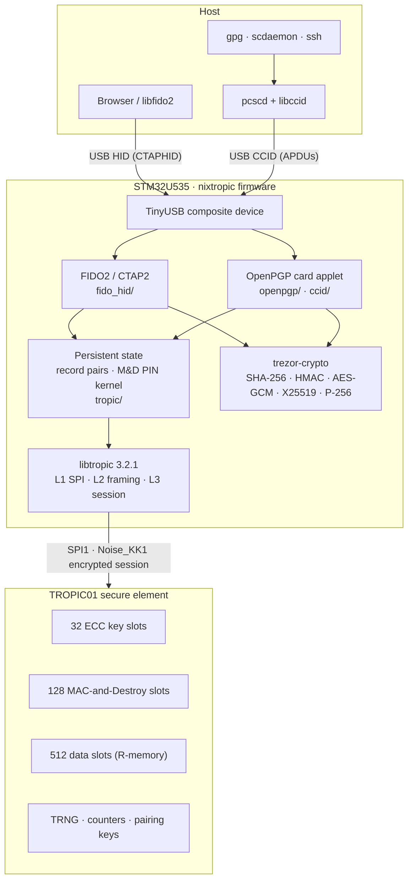
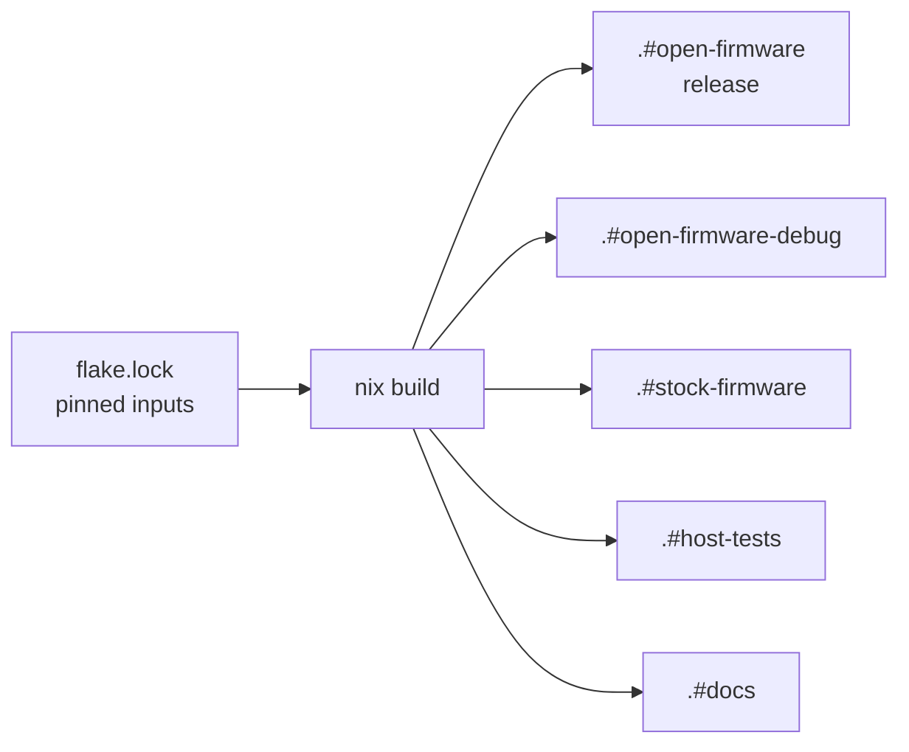

# Architecture

## System view

The STM32 does protocol work: USB, CTAP2 and OpenPGP card parsing, PIN logic,
persistent-state bookkeeping, and the cryptography the chip does not offer. The
TROPIC01 holds keys and secrets, signs, provides randomness, and enforces PIN retry
limits through MAC-and-Destroy.

## What runs where

| Operation | Where | Notes |
|---|---|---|
| FIDO2 signatures (EdDSA, ES256) | TROPIC01 | private key generated in a chip slot, never exported |
| OpenPGP signing and SSH authentication (Ed25519) | TROPIC01 | same |
| OpenPGP decryption (X25519) | STM32 | the chip has no user-key ECDH; the key is stored sealed (see [security](security.md#the-openpgp-decryption-key)) |
| ES256 message hashing | STM32 | libtropic hashes, the chip signs the 32-byte digest |
| FIDO PIN protocol (ECDH P-256, AES, HMAC) | STM32 | CTAP2 ClientPIN, PIN/UV protocol 1 |
| PIN retry enforcement | TROPIC01 | MAC-and-Destroy, see [design](design.md#pins-mac-and-destroy) |
| Random numbers for keys, nonces, PIN secrets | TROPIC01 TRNG | |
| Blinding inside the P-256 software arithmetic | STM32 TRNG | a TRNG failure resets the device instead of returning a substitute value |
| Secure session to the chip | both | X25519 handshake + AES-256-GCM per command |

## USB interfaces

| Build | Interfaces | Product string |
|---|---|---|
| Release (`.#open-firmware`) | IF0 HID FIDO (usage page `0xF1D0`) · IF1 CCID (OpenPGP) | `nixtropic` |
| Debug (`.#open-firmware-debug`) | IF0/1 CDC log console · IF2 vendor HID (lt-rpc) · IF3 HID FIDO · IF4 CCID | `nixtropic debug` |

USB full speed, VID:PID `cafe:4001`. Debug code is compiled out of the release build,
not hidden; a Nix check (`release-surface`) fails the build if debug symbols reach
the release image.

## Firmware modules

| Directory | Responsibility |
|---|---|
| `platform/` | clocks (48 MHz), GPIO, LED, SPI1, STM32 RNG self-test |
| `usb/` | TinyUSB integration, descriptors, CCID class driver |
| `fido_hid/` | CTAPHID framing, CTAP2 commands, CBOR, COSE, ClientPIN, credential store, user presence |
| `ccid/` | ISO 7816 APDU dispatch |
| `openpgp/` | OpenPGP card 3.4.1 applet, PINs, key operations, decryption-key wrap, lifecycle |
| `tropic/` | the only module that calls libtropic: session handling, record pairs, MAC-and-Destroy kernel |
| `hid_rpc/` | lt-rpc vendor interface, debug build only |

### Request handling

USB callbacks only collect data. Requests run from the main loop, one at a time:
CTAP2 from `fido_hid_task()`, APDUs from `usb_ccid_task()`. While a request waits for
a button press, other requests are answered busy (CTAPHID) or held (CCID) — never run
in between. See [design decision 18](design.md#decisions).

### Boot order

Clock → GPIO → SPI → USB clock → STM32 RNG self-test → TROPIC01 session → FIDO state
and PIN → **then** USB. Starting USB last means the host never talks to a device that
cannot answer yet ([decision 21](design.md#decisions)). A failing stage blinks a
distinct LED pattern.

## Persistent state

Everything the dongle remembers lives in the TROPIC01. This is the current layout
(storage schema of v0.3.0).

### Key slots (ECC)

| Slots | Owner | Content |
|---|---|---|
| 0–28 | FIDO2 | one credential key each (Ed25519 or P-256) |
| 29 | OpenPGP | signature key (Ed25519) |
| 30 | — | reserved, unused (the decryption key cannot live in a slot) |
| 31 | OpenPGP | authentication key (Ed25519) |

### Data slots (R-memory)

Objects O1–O6 are **record pairs**: two slots holding the same record, written one after
the other and each read back before the write counts. A record carries a magic, object
id, schema, generation counter and a truncated SHA-256 checksum (an integrity check, not
a MAC). One damaged slot or one interrupted write never rolls back an acknowledged
write; the availability limits are in the
[security model](security.md#persistent-state-under-faults). Credential metadata is a
single slot per credential.

| Object | Content | Slots |
|---|---|---|
| — | FIDO credential metadata (one slot per credential, written once) | 1–29 |
| O1 | FIDO global state: credential bitmap, `alwaysUv`, PIN-set flag | 0 / 40 |
| O2 | FIDO PIN binding | 41 / 42 |
| O3 | OpenPGP state: lifecycle, data objects, counters, touch flag, sealed decryption key (schema 2) | 33 / 43 |
| O4 | OpenPGP PW1 binding | 50 / 53 |
| O5 | OpenPGP PW3 binding | 51 / 54 |
| O6 | OpenPGP Reset Code binding | 52 / 55 |

An empty read is never trusted to mean “fresh device”. A missing PIN binding is checked
against a guard elsewhere: the FIDO PIN against a flag in O1, PW1 and PW3 against the
OpenPGP lifecycle in O3, the Reset Code against its “set” flag in O3. If the guard says
the binding should exist, the PIN reports an error instead of “not set”. A missing O1
or O3, which has no guard, triggers a checked wipe of its whole application before
defaults are written.

### MAC-and-Destroy slots

Each PIN uses two ranges (A/B); a PIN change writes the unused range, commits, then
retires the old one.

| PIN | Range A | Range B |
|---|---|---|
| FIDO PIN (8 tries) | 0–7 | 8–15 |
| OpenPGP PW1 (3) | 16–18 | 19–21 |
| OpenPGP PW3 (3) | 22–24 | 25–27 |
| OpenPGP Reset Code (3) | 28–30 | — |

### Counters

Monotonic counter 0 holds the FIDO signature counter (the chip's counters count down;
the firmware reports `MAX − value`).

## Build

The toolchain is nixpkgs' `gcc-arm-embedded` (Arm GNU 15.2 on nixos-26.05). CMake
builds the firmware; nothing is fetched at build time. `nix flake check` runs the host
tests, the release-surface check and the strict docs build.
