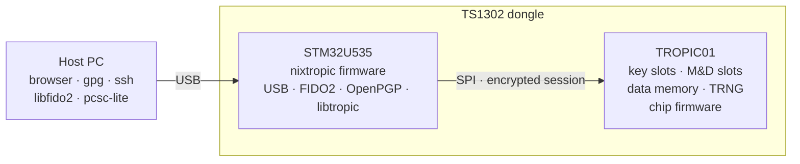

# Recovery

What to do when the dongle misbehaves, and what each kind of reset actually changes.

## Four different operations

They touch different things. Pick the smallest one that fixes the problem.

| Operation | Changes | Keeps | Reversible? |
|---|---|---|---|
| **OpenPGP PW1 change** (`passwd` → 1) | the user PIN | all keys, including decryption | yes |
| **OpenPGP PW1 unblock/reset** (Reset Code or Admin PIN) | the user PIN; **erases the decryption key** | signing and authentication keys, other PINs | no — the decryption key is gone |
| **OpenPGP factory reset** (`factory-reset`) | all OpenPGP keys, PINs, cardholder data | FIDO2 state | no |
| **FIDO reset** (`fido2-token -R`) | all FIDO credentials and the FIDO PIN | OpenPGP state | no |
| **STM32 reflash** (DFU) | the firmware on the STM32 | data on the TROPIC01 | yes, flash again |
| **TROPIC01 firmware update** | the chip's own firmware | data on the TROPIC01 | **no**, one-way |

Application resets are in [card setup](card-setup.md); reflashing is in
[flashing](flashing.md).

## The two chips



DFU writes only the STM32's flash; the keys and data on the TROPIC01 survive a
reflash. A reflash is **not** guaranteed harmless to the chip, though: whatever
firmware runs on the STM32 afterwards can send any command the chip accepts over its
lower protocol layers and, with the public development pairing key, over the encrypted
session too. Flash only firmware you built or trust.

## Failure modes

| Symptom or cause | Recoverable? | How |
|---|---|---|
| STM32 firmware broken or wrong | yes, seconds | [reflash](flashing.md) |
| `gpg --card-status`: `No such device` | yes | [after a replug](linux-setup.md#after-a-replug) |
| Card reads as damaged after an upgrade | yes, data lost | [changelog: upgrading](changelog.md#upgrading) |
| FIDO answers only GetInfo/Reset | yes, data lost | FIDO reset |
| OpenPGP PW1 blocked | yes, decryption key lost | unblock with the Reset Code or Admin PIN |
| OpenPGP PW3 blocked or forgotten | yes, all OpenPGP data lost | `factory-reset` (works without any PIN) |
| FIDO PIN blocked (8 wrong) | yes, all FIDO data lost | FIDO reset |
| STM32 at RDP level 2 without a pre-set unlock key | **no** | nixtropic never changes RDP; don't set it |
| TROPIC01 R-config written without an erase first | **no**, chip in permanent alarm | nixtropic never writes chip configuration |
| TROPIC01 pairing slot SH0 invalidated with no other usable pairing key | **no**, once every open session has ended | nixtropic never writes or invalidates pairing keys |

A TROPIC01 in ordinary Alarm Mode (a tamper sensor fired) returns to normal after a
power cycle; the permanent cases in the table are different.

## Reflash in DFU mode

1. Unplug the dongle, hold SW1, plug it in, release after a second.
2. `lsusb | grep 0483:df11` shows `STM Device in DFU Mode`.
3. Flash:

    ```bash
    nix run github:jjacke13/nixtropic#flash-open      # nixtropic release
    nix run github:jjacke13/nixtropic#flash-stock     # Tropic Square stock firmware
    ```

The dongle restarts into the new firmware.

## TROPIC01 firmware

Checking the chip's own firmware version is described in
[flashing](flashing.md#check-the-tropic01-firmware-version); it needs the stock firmware
on the dongle. Updating it is not covered by these guides
([why](flashing.md#tropic01-firmware-older-than-200)).
