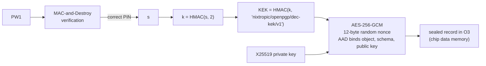

# Security model

This page states what nixtropic v0.3.0 protects, against whom, and what it does not.
Facts about the chips cite the vendor documents listed in [references](references.md).
To report a vulnerability, see
[SECURITY.md](https://github.com/jjacke13/nixtropic/blob/main/SECURITY.md).

!!! warning "Summary"
    v0.3.0 is a **development release on a development board**. It fixes the known
    attack paths from the host found in v0.2 and keeps secrets out of readable chip
    storage; it has not been fuzzed or audited. It does
    **not** resist an attacker who holds the dongle: such a person can make it sign
    while they hold it. It is not certified, not independently audited, and not a
    replacement for a production security key.

## Assets

| Asset | Where it lives |
|---|---|
| FIDO2 credential private keys | TROPIC01 key slots 0–28 |
| OpenPGP signature and authentication private keys | TROPIC01 key slots 29 and 31 |
| OpenPGP decryption private key | TROPIC01 data memory, sealed under a PW1-derived key; in STM32 RAM only during use |
| FIDO PIN, OpenPGP PW1 / PW3 / Reset Code | nowhere as such: each is a MAC-and-Destroy binding on the chip |
| Settings, credential metadata, signature counters | TROPIC01 data memory and counters |

## The pairing key

The STM32 talks to TROPIC01 over SPI. Application commands travel in an encrypted
session (`Noise_KK1_25519_AESGCM_SHA256`) that the host side opens with a **pairing
key**. The chip stores up to four pairing public keys (SH0–SH3) and decides per
pairing slot which commands are allowed (its user access policy).

nixtropic uses SH0 with libtropic’s production key `sh0_prod0`
(`firmware/src/tropic/tropic.c`, session start). That private key is
**public**: Tropic Square publishes it for development and first provisioning.
Consequences:

- Anyone with physical access to the chip's SPI bus, or who runs their own firmware
  on the STM32, can open a session with the same rights as nixtropic.
- The chip checks **which pairing key** opened the session, not whether a person
  entered a PIN. PIN and touch checks are enforced by nixtropic's firmware, so they
  hold only while nixtropic's firmware is what runs.
- The encrypted session protects the SPI traffic; it does not authenticate the
  firmware or the person.
- The firmware extracts the chip's public key from its certificate store but does not
  verify the full certificate chain.

SH0 cannot be overwritten (PAIR §1.2 p3, DS §7.5.3 p44). Moving to a private pairing
key means writing a new public key into one of the three initially blank slots (one-way), keeping
its private key where the STM32 does not leak it, and then restricting SH0 through the
access policy (R-config, reversible) or invalidating it (permanent). This is planned for
Phase 10 ([roadmap](roadmap.md)).

## Attackers and outcomes

### Malicious software on the host

Software on the computer the dongle is plugged into can send any USB request.

| Defence | Since |
|---|---|
| The release build exposes only FIDO2 HID and the OpenPGP CCID interface; no raw chip access, no debug RPC | v0.3.0 (Phase 9 M1) |
| Every signature needs the PIN rules of its application and, by default, a press of SW1 | earlier, tightened in M3 |
| FIDO2: permission tokens bound to an RP and spent by use; a credential signs only for its own RP | M3 |
| CTAP2 input is validated before parsing (bounded nesting, every length inside the buffer) | M3 |
| One request at a time; a request waiting for touch cannot be overtaken | M3 |

Residual: while the OpenPGP PIN is verified and touch is off, host software can use
the card without further prompts. Keep touch (`uif`) on if that matters.

### Someone who reads the chip's storage

With the publicly known SH0 private key, anyone with access to the chip can read the
user data that SH0’s access policy permits; on this dongle that includes nixtropic’s data
slots, which the firmware itself reads through SH0. TROPIC01’s data memory is encrypted
at rest inside the chip, but an authorized read returns plaintext. Key slots export only
public keys.

| What they find | Since |
|---|---|
| No stored PIN hash or verifier that would let anyone test PINs offline; each PIN is a MAC-and-Destroy binding (its check value is useful only together with the chip) | v0.3.0 (M4) |
| The OpenPGP decryption key only in sealed form | v0.3.0 (M5) |
| Signing keys cannot be read: the chip's key slots export only public keys | always |

### A stolen or borrowed dongle

| They can | They cannot |
|---|---|
| **Make the chip sign** with the FIDO2 and OpenPGP keys while they hold the dongle, by running their own firmware with the public pairing key | extract any signing private key through the chip's interfaces |
| reflash the STM32 (no secure boot, no read-out protection) | decrypt OpenPGP messages without PW1, if PW1 was not verified when they took the dongle (see below) |
| read STM32 memory over the debug port | guess PINs beyond the retry limits: each guess consumes chip state |
| wipe the dongle | recover a PIN from stored data |

!!! danger "If you lose the dongle"
    Revoke its FIDO2 registrations at each site and revoke or rotate the OpenPGP keys.
    A finder who gets the dongle unplugged, or while PW1 is not verified, cannot decrypt
    without the PIN; they can sign while they have it.

One exception to the decryption row: while PW1 is verified, the key that unseals the
decryption key sits in STM32 RAM, which has no read-out protection. Someone who takes the
dongle **while it is plugged in and unlocked**, and keeps it powered, can in principle read
that key from RAM without knowing PW1. Unplugging clears it.

### Physical attacks on the chip

Tropic Square's security advisory `ODR_TR01_SA_2026012900` (disclosed 2026-06-03,
CVSS 3.1 5.7) describes laser fault injection against the chip's firmware signature
check. It lists `TR01-C2P-T101` with bootloader 2.0.1 and enabled sensors among the
affected parts. It is an invasive attack on a decapsulated chip, needed at every boot,
and a successful attack may compromise ECC keys, data memory and MAC-and-Destroy
assets.

- The advisory's mitigations (restricting maintenance mode, a controlled update
  procedure) make the attack harder; they do not cure existing silicon. v0.3.0 applies
  none of them, because they require chip configuration writes.
- The vendor's dated estimates: details of the MAC-and-Destroy vector in the first half
  of 2027 (planned 2027-Q2), hardened parts expected 2026-Q4, exact dates to be
  announced. These are estimates, not commitments.

## The OpenPGP decryption key

TROPIC01's key slots sign (Ed25519, P-256) but offer no X25519 key agreement for user
keys, in any public chip firmware up to 2.2.0. The decryption key is therefore
generated and used on the STM32, and stored like this:

- The KEK is never stored. It exists in STM32 RAM while PW1 is verified (for signing
  or for decryption) and is wiped when the verification ends: unplug, card reset,
  another application selected, a wrong PW1, a PW1 change or reset. A wrong Admin PIN does
  not clear it.
- Unsealing checks the authentication tag first, in constant time, and decrypts only
  after a match. The private key is in RAM only during an operation.
- Generating the decryption key needs the Admin PIN **and** a verified PW1; decrypting
  needs PW1 verified for decryption.
- **A PW1 change keeps the key** (the MAC-and-Destroy secret `s` is kept). **A PW1
  reset destroys it**, checked, before the new PIN is set: the new binding has a fresh
  `s` and could never open the old seal. This is nixtropic's policy; the OpenPGP card
  specification does not require it.

Residuals:

- Someone who knows PW1 and holds the dongle can unseal the key; the seal protects
  against reading storage without the PIN, nothing more.
- While PW1 is verified, the KEK is in STM32 RAM, and the STM32 has no read-out
  protection.
- An older sealed record written under the same KEK can be put back by someone with
  chip access; it unseals, because the KEK has not changed.

## Persistent state under faults

The FIDO global state, the FIDO PIN and the OpenPGP state and PINs (objects O1–O6, see
[architecture](architecture.md#persistent-state)) are mirrored record pairs, written copy
by copy and read back. FIDO credential metadata is one slot per credential, written once
when the credential is created.

For **one** fault — one power cut, one lost chip reply, or one damaged slot of a pair —
the design guarantees **security**: no access is gained (no PIN reads as “not set”, no
extra guess, no key under a default PIN), and an operation reported as successful is
never lost or rolled back. It does not guarantee **availability** in every case:

- An interruption during a correct verification that uses a PIN’s **last** remaining
  try leaves that PIN blocked.
- An interruption inside the first write or the clearing of an object can leave it
  unreadable. It fails closed; the application’s reset recovers it and its data is lost.
- An interrupted PW1 reset can leave the old PW1 in place with the decryption key
  already erased (the key is destroyed before the new PIN is set).
- An operation that reports an error may still have completed on the chip; for example
  a PIN change can fail with the new PIN already active. The next boot settles the state.
- A damaged credential-metadata slot makes that one credential unusable.

Several faults in sequence are outside the guarantee. All of this is tested against a
simulated chip with fault injection, not on silicon: the chip’s own power-loss behaviour
is not established by those tests.

## Randomness

Key material, nonces and PIN secrets come from the TROPIC01 TRNG; the vendor states
NIST SP 800-90B and AIS 31 compliance for its two TRNGs. That is a vendor claim, not
a certification of this device. The STM32's TRNG is used only for blinding inside the
software P-256 arithmetic; if it fails, the device resets instead of continuing.

## Part status and errata

- **`TR01-C2P-T101` is listed as DEPRECATED** on Tropic Square's part page, which
  recommends a newer part. The project's dongle uses it with chip application firmware
  2.0.0 and SPECT firmware 1.0.0.
- Erratum **`OI_TR01_ERR_2026090100`** ("RNGTEST_DIS CO bit not programmed on some
  part numbers", published 2026-09-10): the affected parts, the shipped bit values and
  the corrective procedure are not verified for this dongle. Its applicability is
  **unresolved**; it is not evidence that this chip's TRNG is broken. v0.3.0 makes no
  configuration change for it.
- Erratum `OI_TR01_ERR_2026010800`: writing the chip configuration without erasing it
  first puts the chip into permanent alarm. nixtropic never writes the configuration.

## The STM32 side

The STM32U535 runs at read-out protection level 0 with TrustZone unused: its flash and
RAM are readable through the debug port, and DFU accepts any image. What the STM32
holds:

- always: the pairing private key (public anyway) and the firmware;
- while PW1 is verified: the KEK; during a decryption: the decryption private key;
- during FIDO2 PIN operations: the PIN-protocol session keys.

The U535 has no AES engine of its own (no SAES), so there is no hardware-held key to
protect data on the STM32 side. Read-out protection and TrustZone are Phase 10 topics;
neither is a small change, and RDP level 2 is permanent unless an OEM2 unlock key was
provisioned beforehand.

## Fixed in v0.3.0

Weaknesses of v0.2 that this release closes:

| v0.2 weakness | Fixed by |
|---|---|
| A USB serial interface passed raw SPI to the chip, and a vendor HID interface could sign, erase and allocate without PIN or touch | removed from the release build (M1) |
| FIDO2 assertions did not check the credential's RP | M3 |
| CTAP2 CBOR parsing had no nesting limit | M3 |
| The P-256 software arithmetic drew its blinding from a fixed-seed PRNG | STM32 TRNG (M2) |
| Failed chip erases were reported as success; signature-counter errors were ignored | M2, M3 |
| PIN hashes stored in readable chip memory; some PIN errors fell back to a software check | M4 |
| Transient chip errors could make state look fresh and be overwritten | M4 |
| OpenPGP PIN verification state survived card resets; signature-PIN mode was not enforced | M4 |
| The OpenPGP decryption key stored in plain form | M5 |

The full analysis is in the
[Phase 9 plan and design documents](https://github.com/jjacke13/nixtropic/tree/main/docs/history).

## What is not claimed

- No FIDO Alliance or OpenPGP certification, no conformance test suite run, no
  independent audit.
- No resistance to physical attacks on the STM32 or the chip beyond what the chip's
  own sensors provide.
- No side-channel hardening of the STM32 software crypto beyond the P-256 blinding.
- The source is open; the TROPIC01 is an open-architecture chip, but this is not a claim
  that every part of the hardware is open or verified.
