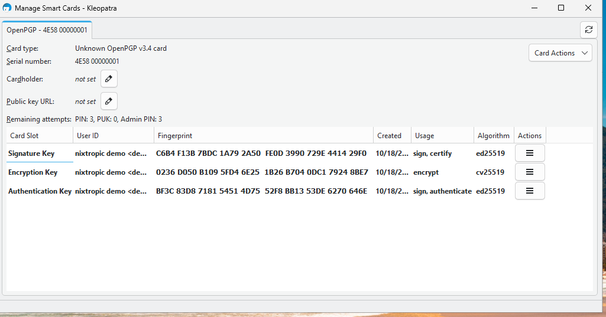

# Windows

The dongle needs no driver on Windows: both interfaces bind to Windows' in-box class
drivers (HID for FIDO2, the Microsoft USB CCID driver for the smart card). Tested on
Windows 11 in a VirtualBox VM with USB passthrough: v0.3.0 on 18 October 2026, v0.3.1 on
19 October 2026, release builds.

| Feature | v0.3.0 | v0.3.1 |
|---|---|---|
| USB enumeration, no driver install | works | works |
| OpenPGP card with Gpg4win / Kleopatra: card view, sign, encrypt, decrypt | works | not re-tested on Windows (Linux suites pass) |
| FIDO2 touch (device selection) | works | works |
| FIDO2 registration and login with a PIN set (Brave, webauthn.io) | **fails** | works — see [FIDO2 with a PIN](#fido2-with-a-pin) |
| FIDO2 slow touch (10 s) and Cancel in the Windows dialog | not tested | works |
| FIDO2 PIN change (Windows Settings) | **reports an error**, although the change completes | works |
| SSH through gpg-agent | not tested | not tested |
| Flashing from Windows | not tested — flash from Linux | not tested |

## OpenPGP card

1. Install [Gpg4win](https://gpg4win.org).
2. Create `%APPDATA%\gnupg\scdaemon.conf` (Win+R → `%APPDATA%\gnupg`) with:

    ```text
    disable-ccid
    pcsc-shared
    ```

    The reasons are the same as on Linux: see [Linux setup](linux-setup.md#gnupg).

3. In PowerShell:

    ```powershell
    gpgconf --kill scdaemon
    gpg --card-status
    ```

    If it reports no card, reboot Windows once.

4. Kleopatra → **Tools → Manage Smart Cards** shows the card and its three keys. Import
   your public key (File → Import) and the keys appear with their user IDs:

    

5. Sign, encrypt and decrypt from Kleopatra's Notepad or the file actions. Each operation
   asks for the user PIN and, with the default touch policy, a press of SW1.

Card setup (PINs, touch policy, key generation) works with `gpg --card-edit` exactly as
described in [card setup](card-setup.md).

## FIDO2 with a PIN

Works from v0.3.1: registration and login with a PIN (Brave on webauthn.io), a touch
after a 10 s wait, Cancel in the Windows dialog, and a PIN change in *Settings → Accounts
→ Sign-in options → Security key*. The Settings dialog may close without a confirmation;
the USB capture shows the dongle answering the PIN change with success.

**What was wrong in v0.3.0.** The dongle sent nothing while it worked on a PIN operation,
and Windows abandons a silent request after a few seconds. USB captures showed it giving
up on the PIN token after 2.6 s and on a PIN change after 6.6 s; the dongle's successful
answer arrived 1–2 ms later in both cases, so registration looped back to the PIN prompt
and a PIN change reported "Something went wrong" although it had taken effect. Linux
clients wait for the answer and were not affected.

**The fix.** v0.3.1 sends CTAPHID **KEEPALIVE** packets on the request's channel while it
runs: status PROCESSING between chip operations, UPNEEDED while it waits for SW1
([CTAP 2.2 §11.2.9.1.7](https://fidoalliance.org/specs/fido-v2.2-ps-20250714/fido-client-to-authenticator-protocol-v2.2-ps-20250714.html#usb-hid-keepalive)).
In the 19 October captures the longest silence during a request is 240 ms; the PIN
token (2.6 s) and the PIN change (6.6 s) now complete. The specification recommends a
KEEPALIVE at least every 100 ms; the PIN operations reach about 250 ms because one step,
the P-256 key agreement in software on the STM32, cannot be interrupted. See
[testing](testing.md) for the per-operation timings.

!!! note "alwaysUv after a reset"
    After a FIDO2 reset (for example *Reset security key* in Windows Settings), setting
    the first PIN also turns on **alwaysUv**: every registration and login then asks for
    the PIN, even where the site does not. This is the design since Phase 6, not a
    Windows effect. It can be switched off with authenticatorConfig, for example
    `fido2-token -D -u /dev/hidrawN` on Linux.

## Flashing from Windows

Not tested. The STM32 DFU device (`0483:df11`) probably needs [Zadig](https://zadig.akeo.ie/)
to bind WinUSB for `dfu-util.exe`, or ST's STM32CubeProgrammer with its signed driver.
Flash from Linux for now.

## SSH

Not tested. Gpg4win's agent can serve SSH with `enable-win32-openssh-support` in
`gpg-agent.conf` and the built-in `ssh-agent` service disabled.

## Testing in a VirtualBox VM

Pass the dongle through: VM settings → **USB** → enable the USB controller → add a filter
for **nixtropic nixtropic** (`cafe:4001`), or attach it at run time with
**Devices → USB**. While the VM holds the dongle, the Linux host cannot use it; stop the
host's `pcscd` first if it holds the reader.
